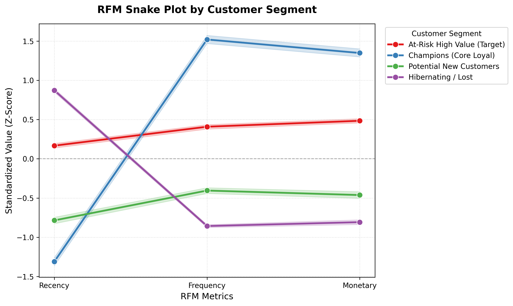

# Ecommerce-retail-analytics
## 專案摘要（Executive Summary）
本專案針對英國線上禮品零售商（Online Retail 資料集，2010/12 – 2011/12 共 541,909 筆交易紀錄），從**「人（顧客價值）」、「貨（商品與退貨損耗）」、「時（銷售季節與時段規律）」**三大維度進行全盤數據體檢，並將統計分析轉化為可落地的商業決策閉環：

* **顧客價值與流失預警（RFM + K-means）**：將 4,338 位會員分為 4 群（Kruskal-Wallis 檢定 $p < 0.001$），識別出僅佔總人數 **[28.9%]** 卻貢獻 **[24.4%]** 歷史營收的「高價值流失預警客」，建議集中預算發送個人化回歸折價券進行挽留。
* **退貨異常與毛利出血點診斷**：精準過濾 11 種非實體商品費用代碼（如郵資、手續費），透過四象限分析鎖定「高銷量 × 高退貨率」商品（如 **[21108，退貨率 30.72%]**），並揭露單筆巨額取消訂單（如單筆退貨高達 £168,469）的 B2B 批發風險。
* **營收季節性與推播排程優化**：發現 9–11 月為聖誕節批發備貨旺季（11 月營收達全年高峰），且全站訂單高度集中於**週二至週四 10:00–15:00**（週六無單），為行銷 EDM 發送與客服人力排班提供精準時間表。
  
 ---

## 📂 專案架構與 Kaggle 完整程式碼

本專案採用模組化架構，針對不同分析目的設計獨立的資料清整規則，避免指標互相干擾：

| 分析模組 | 核心問題 | 關鍵清整邏輯 | 完整程式碼（Kaggle） |
| :--- | :--- | :--- | :--- |
| **01. 顧客價值與流失預警** | 誰是主力金主？誰快流失？ | 剔除訪客（CustomerID 空值）與退貨單，計算純淨消費 | [點此查看 Notebook 01](https://www.kaggle.com/code/celina6318/01-rfm-customer-segmentation) (`notebooks/01_rfm_customer_segmentation.ipynb`) |
| **02. 退貨異常與毛利控管** | 哪些商品、國家或大戶在侵蝕毛利？ | 保留 `C` 開頭退貨單與負數數量，剔除 11 種非實體費用代碼 | [點此查看 Notebook 02](https://www.kaggle.com/code/celina6318/02-return-anomaly-diagnosis) (`notebooks/02_return_anomaly_diagnosis.ipynb`) |
| **03. 營收趨勢與營運排程** | 何時該提前備貨？何時推播與排班？ | 保留訪客紀錄反映全站真實流量，剔除退貨與非實體費用 | [點此查看 Notebook 03](https://www.kaggle.com/code/celina6318/03-sales-trend-and-schedule) (`notebooks/03_sales_trend_and_schedule.ipynb`) |

---

## 📊 第一部分：顧客價值分群與流失預警（人）

### 1. 資料預處理與分群依據
* **資料清整**：剔除無法歸戶的訪客紀錄（約 13.5 萬筆）、`C` 開頭退貨單及異常單價後，共保留 **4,338 位獨立會員**。
* **偏態修正與標準化**：針對嚴重右偏的 R、F、M 指標進行 `np.log1p` 對數轉換並搭配 `StandardScaler` 標準化，避免極端批發大戶拉偏群組中心點。

* **最佳分群數評估與統計檢定**：結合手肘法（Elbow Method）與輪廓係數（Silhouette Score），並考量行銷團隊的可執行性，最終選定 **$K = 4$**。經 **Kruskal-Wallis 無母數檢定**，四群在 Recency、Frequency、Monetary 上皆達極度顯著差異（**$p < 0.001$**）。

### 2. 客群畫像與營收貢獻（二八法則驗證）

| 商業客群標籤 | 消費特徵（R / F / M） | 人數佔比 | 營收貢獻佔比 | 精準行銷行動建議 |
| :--- | :--- | :---: | :---: | :--- |
| **核心忠誠客 (Champions)** | 近期回購、高頻率、高消費 | `[XX%]` | `[YY%]` | 減少價格折扣（保護毛利），改推 VIP 會員制與新品優先購。 |
| **高價值流失預警客 (Target)** | **久未回購，但過去頻率與金額極高** | `[XX%]` | `[YY%]` | **優先挽留目標！** 超過回購週期自動觸發高面額專屬折價券。 |
| **潛力新客 (Potential New)** | 近期剛首購，次數與金額尚低 | `[XX%]` | `[YY%]` | 首購後 7–14 天發送「第二件優惠」或免運券，引導完成二購。 |
| **一般流失客 (Hibernating)** | 久未回購，且過去頻率與金額皆低 | `[XX%]` | `[YY%]` | 降低日常推播預算，僅於大型節慶進行低成本群發觸及。 |

---
